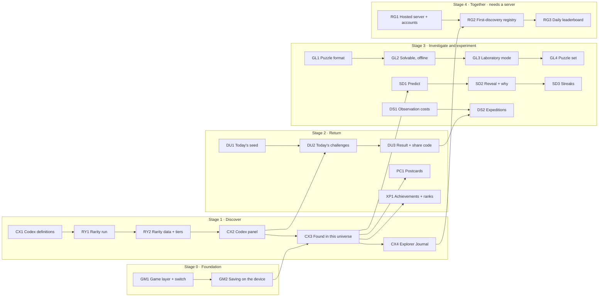

# The plan: Gameplay

*A universe worth investigating: the Codex, the Daily Universe, Spectral Detective, the Great Filter Laboratory and Deep Survey*

Aion Forge · planning document · rules version 18 · 30 Oct 2026

Status: planned. Nothing in this plan has been implemented yet. The decisions in [Decisions needed](#decisions-needed) carry the recommendations as placeholders until the owner decides.

## Contents

- [Summary](#summary)
- [The idea in one line](#the-idea-in-one-line)
- [Starting point](#starting-point)
- [Ground rules for every step](#ground-rules-for-every-step)
- [Build order](#build-order)
- [Stage 0 — Foundation](#stage-0--foundation)
- [Stage 1 — Discover](#stage-1--discover)
- [Stage 2 — Return](#stage-2--return)
- [Stage 3 — Investigate and experiment](#stage-3--investigate-and-experiment)
- [Stage 4 — Together (needs a server)](#stage-4--together-needs-a-server)
- [Stage 5 — Endgame (needs Deep Time, SETI and Contact)](#stage-5--endgame-needs-deep-time-seti-and-contact)
- [Where the code goes](#where-the-code-goes)
- [Determinism](#determinism)
- [Versions](#versions)
- [Play Store and young players](#play-store-and-young-players)
- [Risks](#risks)
- [Decisions needed](#decisions-needed)
- [Not in this plan](#not-in-this-plan)

---

## Summary

To go to the Play Store, Aion Forge needs reasons to come back: things to chase, and recognition for finding them. This plan adds those without adding quests. Each mechanic is one of the things Aion Forge already does, read as a game:

| Pillar | Mechanic | Built from |
|---|---|---|
| Discover | **Cosmic Codex**: a collection of kinds of things the universe makes, each with a rarity the simulation measures | The universe index, the stats harness |
| Investigate | **Spectral Detective**: predict what a world is from its spectrum before approaching it | `simulation/detection.ts`, the spectrum panel |
| Investigate | **Deep Survey**: find a target with a fixed number of observations | The galaxy, star, spectrum and planet views |
| Experiment | **Great Filter Laboratory**: change as few laws of physics as possible to get a world through a gate | The Reality panel, `simulation/greatFilter.ts` |
| Compete | **Daily Universe**: the same seed for every player each day, with a code anyone can replay | Determinism |
| Preserve | **Explorer Journal**, names, postcards; later a shared registry of first discoveries | `simulation/journal.ts`, the discoveries collections |

Achievements and explorer ranks sit on top of these and reward only what the five pillars record.

The first release (Stages 0–3) needs no server and no accounts. A shared registry and leaderboards (Stage 4) wait for a hosted server. First Contact and Deep Time achievements (Stage 5) wait for the Galaxy Through Time steps that make them real.

## The idea in one line

Aion Forge does not give players things to do. It gives them a universe worth investigating, and tells them, honestly, how rare what they found is.

The player can still open a galaxy, approach a system and simply watch. The game layer adds no markers, currencies or pop-ups to that. Somewhere in the universe there may be an extraordinarily rare moon, and the player knows it.

---

## Starting point

Measured or read from the code at commit `583ad8b` (rules v18).

- **Six laws** in the Reality panel (`simulation/config.ts`): gravity strength, expansion rate, stellar ignition threshold, entropy rate, emergence sensitivity, intelligence modifier; six presets.
- **Twelve Great Filter gates** (`simulation/greatFilter.ts`): solid surface, liquid water at some time, life began, life used starlight, life's oxygen filled the air, a multicellular body, a mind, fire within the mind's reach, industry reached, global communication reached, spaceflight reached, still active today. Seed 100000, Familiar Reality: 5,806 / 2,690 / 2,062 / 388 / 151 / 115 / 10 / 3 / 3 / 3 / 0 / 0. In stats run v17, Eternal Stars brings worlds of seeds 100000 and 42 through all twelve. There is room for puzzles.
- **Spectrum verdicts** (`simulation/detection.ts`): technosignature, strong biosignature (chemical disequilibrium), possible biosignature, ambiguous, atmosphere, none; each detection has a significance in σ.
- **Saved collections** (`simulation/persistence.ts`): favourite stars, remarkable worlds, extraordinary civilizations, historic events, through `backend/` (Express + MySQL). **On the phone saving is off** (`VITE_STORAGE=off` in `frontend/.env.android`): there is no backend there.
- **Survey time.** On the owner's phone, seed 100000: 84–145 s with battery saver set to "No restrictions", about 4:30 with HyperOS's default battery saver (`Mobile-APK.md`, M5, measured 9 Oct 2026, rules since then heavier). On the desk machine the stats harness took 65–155 s per universe at v17, measured with universes running in parallel. A player waits for a survey once per universe; anything that needs a new survey (a laboratory attempt) costs that wait again.
- **Already simulated, so already collectable:** red giants, white dwarfs, neutron stars and stellar black holes; the galaxy's central black hole; lava, ocean, frozen, ice-shell and frozen-solid worlds; compact, distributed, resonant and chaotic systems; binary stars and planets around both stars; moons warmed by tides, and their hidden oceans; tidally locked worlds; each world's habitability score; biospheres and the tree of life; civilizations living and in ruins.
- **Not simulated:** supernovae as events, captured moons, stars that died long ago, the future. Rogue planets become real with RP2–RP5; galactic history with Deep Time (DT).

---

## Ground rules for every step

1. **Nothing in `src/simulation/` changes.** The game layer reads the universe and never writes to it. No rules version bump comes from this plan. A test enforces the direction: `src/simulation/` never imports `src/game/`.
2. **The game layer can be switched off.** With it off, the app behaves exactly as it does today. A build flag sets the default (on in the phone build, off on the desktop), and the settings can turn it off.
3. **No hidden randomness.** Every choice the game layer makes (today's seed, today's challenges, a Deep Survey's target) comes from a date or a seed through `simulation/detmath` and a hash, never from `Math.random`. See [Determinism](#determinism).
4. **No authored outcomes and no authored rarity.** A Codex entry is a definition over the simulation's data; its rarity is what the rarity run measures. Nothing is made rarer or commoner by hand.
5. **No speed scoring.** Scores read reasoning (what was found, how many observations it took, whether a prediction was right), never time or reflexes, so a slow phone is not a handicap.
6. **Honest about the model.** A spectrum gives evidence, not proof; a rarity has a confidence interval; a Codex entry the simulation cannot make yet is not shown as if it could.
7. **Forgiving.** Missing a day or breaking a streak never takes away what was earned.
8. **Presentation stays calm.** At most one quiet notice when a Codex entry is found. No badges over the universe, no currencies.

---

## Build order



| Step | Phase-lets | Size | Server? | You can see |
|---|---|---|---|---|
| 0 | GM1–GM2 | M | No | A game switch in the settings; progress kept on the phone |
| 1 | CX1–CX4, RY1–RY2 | L | No | The Codex: what the universe can make, how rare each is, what you have found |
| 2 | DU1–DU3, XP1, PC1 | M–L | No | Today's universe, its challenges, a code to share; achievements; postcards |
| 3 | SD1–SD3, GL1–GL4, DS1–DS2 | L | No | Spectral Detective, laboratory puzzles, Deep Survey expeditions |
| 4 | RG1–RG3 | XL | Yes | Global first discoveries; a daily leaderboard |
| 5 | (defined later) | — | — | First Contact and Deep Time achievements |

Two-letter codes, chosen not to collide with Galaxy Through Time (EN, GF, AE, MZ, IH, MO, BS, RP, GA, DT, SE, CC), Worlds Up Close (A, B, C2, D), the phone (M), sound (S), the Physics page (PH) or the black hole (BH): GM game layer, CX Codex, RY rarity, DU Daily Universe, XP achievements and ranks, PC postcards, SD Spectral Detective, GL Great Filter Laboratory, DS Deep Survey, RG registry.

Sizes as in Galaxy Through Time: **S** about one working session, **M** two to three, **L** four to six, **XL** more than six or with research risk.

---

## Stage 0 — Foundation

#### GM1 The game layer and its switch
`infrastructure` · **S**

- **Objective:** A home for the game layer that cannot reach into the simulation, and a switch that removes it.
- **Deliverables:** `src/game/` (new); `VITE_GAME` (`on` in `.env.android`, unset on the desktop); a settings toggle; a test that no file in `src/simulation/` imports from `src/game/`.
- **Verification:** With the switch off, the app is unchanged (the existing tests pass, and the screens look the same); the import test fails if the rule is broken.

#### GM2 Saving on the device
`infrastructure` · **S**

- **Objective:** The phone keeps the player's progress (Codex finds, journal, streaks, achievements) without a server.
- **Deliverables:** `src/game/store.ts`: one small module that reads and writes the game record, versioned, with an export to a file and an import from it. Storage: the WebView's own storage (decision 8).
- **Implementation:** The record holds facts the player earned, never the universe: for each find, the Codex entry id, the object's citation (`AF-U-… · v18 · 1300 c`, decision 1 of Galaxy Through Time), the date and the Codex version. A find can always be checked again by regenerating its star's system.
- **Verification:** Survives closing and reopening the app; export then import gives the same record; a record from a newer format is refused with a message, not dropped.

---

## Stage 1 — Discover

#### CX1 Codex definitions
`presentation` · **M**

- **Objective:** The list of kinds of things a player can find, each a precise rule over data the simulation already produces.
- **Deliverables:** `src/game/codex/definitions.ts`. Each definition has an id, a name, a category, a one-line description, **the population it is counted against** (the objects that could qualify), and the test.
- **Implementation:** Categories: stars, worlds, systems, moons, extreme objects, biospheres, civilizations. A first set, all from existing data:

  | Entry (examples) | Counted against |
  |---|---|
  | White dwarf, neutron star, stellar black hole, red giant | Stars |
  | Lava world, ocean world (> 90 % ocean), frozen solid, ice-shell ocean | Solid planets |
  | Tidally locked world with life | Living worlds |
  | Resonant system, chaotic system | Systems with two or more planets |
  | Planet around both stars | Planets in binaries |
  | Tide-warmed moon with a hidden ocean | Moons of at least 0.018 M⊕ |
  | Life that never used light | Living worlds |
  | A world where life ended | Living worlds |
  | A mind under water | Worlds with a mind |
  | Civilization that reached spaceflight; civilization in ruins | Worlds with a mind |

  The list is a starting point, not the plan's decision: entries are added only where the rule is a plain reading of the data. Entries the simulation cannot make yet (rogue planets until RP2) are not listed until it can (decision 12).
- **Verification:** Each definition has a test on a known seed that names an object it accepts and one it rejects.

#### RY1 The rarity run
`infrastructure` · **M**

- **Objective:** Measure how often each Codex entry occurs.
- **Deliverables:** `frontend/stats/rarity.mjs`, using the same modules and worker pool as `stats/run.mjs`.
- **Implementation:** For every seed in a fixed list, survey the universe under Familiar Reality and count, per entry, its population and its matches. Rarity is counted **per qualifying object** (decision 1), so a few hundred seeds suffice for most entries: each universe has about 7,000 planets and 2,000 stars. At roughly 20–90 s per universe on the desk machine, 500 seeds take about 3–12 hours on 3–4 cores (an estimate, not measured). Entries that are rare per universe (spaceflight: 0 in seed 100000) are reported as such and may need more seeds.
- **Verification:** The same seed list gives the same counts on two runs.

#### RY2 Rarity data and tiers
`presentation` · **S**

- **Objective:** Turn the counts into a rarity the player sees, with its uncertainty.
- **Deliverables:** `src/game/codex/rarity.v18.json` (written by RY1, checked in); the tier rule in `src/game/codex/rarity.ts`.
- **Implementation:** For each entry: seeds run, population, matches, the share, its 95 % Wilson interval, the rules version and the Codex version. With no match in n qualifying objects, the entry reads "fewer than 1 in n/3" (the 95 % bound). Tiers from the share (decision 9, thresholds to set after the first run): common above 10 %, uncommon 2–10 %, rare 0.2–2 %, epic 0.02–0.2 %, legendary below 0.02 %. An entry whose interval straddles a boundary takes the commoner tier, so nothing looks rarer than the evidence shows. The panel shows the share and the interval alongside the tier, and a second line for what rarity does not measure (decision 10: no separate "significance" score; the entry's description says why it matters).
- **Verification:** A test over a small fixture of counts gives the expected tiers and bounds.

#### CX2 The Codex panel
`presentation` · **M**

- **Objective:** See every entry, its rarity, and whether you have found it.
- **Deliverables:** `ui/CodexPanel.tsx`, next to the encyclopedia.
- **Implementation:** Entries grouped by category; found ones show where (the citation) and when; unfound ones show their name, rarity and description, so the player knows what to look for, but not where. A link from each found entry opens the object.
- **Verification:** Screenshots on the phone and the desktop.

#### CX3 Found in this universe
`presentation` · **S**

- **Objective:** Recognise an entry when the player finds it.
- **Depends on:** CX1, GM2.
- **Implementation:** An entry counts as found when the player **opens** a qualifying object (its panel), not when the survey merely contains one: the survey knows everything; the player has to look. One quiet notice per new entry.
- **Verification:** Opening a qualifying object records it once; reopening does not.

#### CX4 Explorer Journal
`presentation` · **M**

- **Objective:** A record of what the player did, beside the record of what exists.
- **Deliverables:** The journal panel, built on `simulation/journal.ts`'s bookmarks: Codex finds, daily results, puzzles solved, spectral predictions, in date order.
- **Implementation:** The Codex is what exists in the universe; the journal is what you experienced.
- **Verification:** Each kind of event appears once, in order, and survives a restart.

---

## Stage 2 — Return

#### DU1 Today's seed
`presentation` · **S**

- **Objective:** Every player gets the same universe each day.
- **Deliverables:** `src/game/daily.ts`.
- **Implementation:** The day is the UTC date (decision 7). Seed = a fixed integer hash of the day number, through `detmath`. Familiar Reality, default parameters. The universe is surveyed once that day and kept for the day.
- **Verification:** A given date always gives the same seed; the seed changes at 00:00 UTC.

#### DU2 Today's challenges
`presentation` · **M**

- **Objective:** Three challenges each day, chosen from the universe itself.
- **Depends on:** DU1, CX2.
- **Implementation:**
  - **The rarest find:** find the rarest Codex entry present in today's universe (the game knows which, from the survey; the player does not).
  - **Find a mind:** locate a world with a mind in the fewest observations. If today's universe has none, this challenge is replaced by the first that applies from a fixed list (a living moon, a planet around both stars, …), chosen by the day's seed.
  - **One of a kind:** find the only object in today's universe with a stated property (for example "the only tidally locked world with complex life"), drawn by the day's seed from properties that hold for exactly one object.
  - Challenges come from the universe and a hash of the day, through a stream of the game layer's own, never from the simulation's random streams.
- **Verification:** The same date gives the same challenges; every challenge chosen is solvable in that universe (a test over a year of dates).

#### DU3 The result and its share code
`presentation` · **S**

- **Objective:** A result a player can post, and a code that lets anyone play the same day.
- **Implementation:**
  - Code: `AF-D-2026-11-03 · v18 · g1` (day, rules version, game version). The app opens a code only if it runs the same rules and game version; otherwise it says which version the code needs and shows any saved result read-only (decision 2).
  - Result: three numbers side by side, not one sum: found or not, observations used, the rarity tier of the find (decision 6). No timing.
  - Shared as text, like a daily word game's grid.
- **Verification:** A code typed on another phone opens the same universe and the same challenges.

#### XP1 Achievements and ranks
`presentation` · **S**

- **Objective:** Milestones across the pillars.
- **Implementation:** Achievements are conditions over the game record (for example: ten Codex entries; a legendary find; seven daily universes; a gold puzzle; twenty-five correct spectral predictions). Explorer rank comes from the number of distinct Codex entries found, weighted by nothing (decision 11): no XP for taps, views or time spent.
- **Verification:** Each achievement has a test against a constructed record.

#### PC1 Postcards
`presentation` · **M**

- **Objective:** A picture worth sharing that carries its way back into the universe.
- **Implementation:** From the planet, system, black hole or tree-of-life view: a still image with the object's name, Codex entry, rarity and citation. Shared through Android's share sheet (a small Capacitor plugin, like `KeepAwakePlugin`), or saved. Ten-second clips and deep links are left for later.
- **Verification:** The citation on a postcard, typed into Find a star, opens the same object.

---

## Stage 3 — Investigate and experiment

#### SD1 Predict
`presentation` · **M**

- **Objective:** The player reads a spectrum and says what the world is before approaching it.
- **Implementation:** From the spectrum panel, before Approach: choose one verdict (no atmosphere, atmosphere, possible biosignature, strong biosignature, technosignature) and optionally "rocky or giant" and "liquid water". The spectrum the player sees is the one the panel already builds.
- **Verification:** A prediction is recorded once per world and cannot be changed after the reveal.

#### SD2 Reveal, and why
`presentation` · **S**

- **Objective:** Say whether the prediction was right, and what in the spectrum showed it.
- **Implementation:** The prediction is scored against the verdict the evidence supports (`detection.ts`), the thing a careful reader of that spectrum could know, not against the hidden truth (decision 5). The reveal then shows the truth beside it ("the evidence said ambiguous; the world has microbial life"), and the gases and their σ that decided the verdict. No verdict is called proof.
- **Verification:** A test on known worlds of seed 100000 for each verdict.

#### SD3 Streaks
`presentation` · **S**

- **Implementation:** A streak counts correct predictions in a row; titles at 3, 5, 10 and 25 are kept for good once earned. A wrong prediction ends the streak; it never removes a title.

#### GL1 The puzzle format
`presentation` · **S**

- **Objective:** A laboratory puzzle as data.
- **Implementation:** Seed, starting preset, the laws that may change, the goal (at least one world through a named gate; optional constraints such as "do not change gravity"), and the change counts for gold, silver and bronze. A change is one law moved from its starting value, by any amount.
- **Verification:** The format validates, and an invalid puzzle is refused.

#### GL2 Solvable, offline
`infrastructure` · **M**

- **Objective:** Every puzzle shipped is known to be solvable, with its medal thresholds set from a known solution.
- **Deliverables:** `frontend/stats/puzzles.mjs`: for each candidate puzzle, search a coarse grid of law values with the fewest changes first, record the best solution found, and set gold at that count (silver and bronze above it).
- **Verification:** The stored solution reaches the goal when replayed.

#### GL3 Laboratory mode
`presentation` · **M**

- **Objective:** Try a puzzle without touching your own universe.
- **Implementation:** Each attempt is a universe of its own, from the puzzle's seed and the player's laws, as the laboratory already does; the player's main universe is never changed. Checking an attempt needs a full survey: about 1.5–2.5 minutes on the owner's phone (decision 4); the attempt screen says so and shows the funnel as it fills. The result is the Great Filter funnel, the goal gate marked.
- **Verification:** The same laws give the same funnel every time; the main universe is unchanged after an attempt.

#### GL4 A first set of puzzles
`presentation` · **S**

- **Implementation:** Ten puzzles, from "get life to use starlight in Fragile Life" to "a world still active today, from Familiar Reality". Each with its solution from GL2.

#### DS1 Observation costs
`presentation` · **S**

- **Objective:** A mode where looking costs something. Free exploration is never limited (decision 3).
- **Implementation:** Looking at the galaxy and at a star's panel is free; a spectrum costs 1 observation; approaching a planet costs 2; opening a civilization's record costs 3.

#### DS2 Expeditions
`presentation` · **M**

- **Implementation:** An expedition is a seed, a budget (for example 12) and an objective (for example "find a world with life that uses starlight"), drawn from a seed of its own. The result: found or not, observations used, rarity of the find. Daily expeditions use the day's universe (DU1).
- **Verification:** The same expedition code gives the same objective and budget.

---

## Stage 4 — Together (needs a server)

Not part of the first release. Each step needs a hosted server, player accounts and personal data, and with them a privacy policy and the Play Store's data safety answers (see [Play Store and young players](#play-store-and-young-players)).

- **RG1 Hosted server and accounts.** The backend runs only on the owner's computer today. Hosting it, signing players in, and keeping their data safe is a plan of its own.
- **RG2 First-discovery registry.** A player's personal names stay on their phone. Global first-discovery credit is given only by the server, which checks a claim by regenerating the star's system from the citation (one system, not the whole universe, since each system is generated on its own). Editing a local record can never claim it.
- **RG3 Daily leaderboard.** From verified daily results only.

## Stage 5 — Endgame (needs Deep Time, SETI and Contact)

First Contact (detect a signal, locate its civilization, establish contact) and Deep Time (watch a galaxy from its first stars to today) are the long-term goals. Their achievements are defined when Galaxy Through Time's DT, SE and CC steps are built, from what those steps actually simulate. Until then none is listed. Deep Time runs from the galaxy's formation to the present (Galaxy Through Time decision 18, recommended), so there is no "Witness to Eternity".

---

## Where the code goes

```text
frontend/src/game/              the game layer (new); reads simulation/, never imported by it
  store.ts                      the player's record on the device (GM2)
  daily.ts                      today's seed and challenges (DU1–DU2)
  codex/definitions.ts          Codex entries (CX1)
  codex/rarity.ts               tiers and bounds (RY2)
  codex/rarity.v18.json         measured rarity, per rules version (RY1)
  detective.ts                  predictions and scoring (SD)
  laboratory/puzzles.ts         puzzle format and set (GL1, GL4)
  survey.ts                     Deep Survey costs and expeditions (DS)
  achievements.ts               achievements and ranks (XP1)
frontend/src/ui/                CodexPanel, JournalPanel, DailyPanel, puzzle and expedition screens, postcards
frontend/stats/rarity.mjs       the rarity run (RY1)
frontend/stats/puzzles.mjs      the puzzle solver (GL2)
```

## Determinism

The game layer adds three inputs, all stated: the UTC date (Daily Universe), a puzzle or expedition code, and what the player does. Everything chosen from them goes through `detmath` and a hash of the game layer's own, so the simulation's streams (`SALT`) are untouched and no simulated outcome changes. Two phones on the same date with the same version see the same universe, the same challenges and the same answers.

## Versions

Three versions travel together and are named in every code and record: the **rules version** (the simulation, v18 today), the **game version** (definitions, challenge rules, scoring), and the **rarity data** (`rarity.v18.json`). A rules bump means a new rarity run before release. A Codex find keeps the version it was made under, so an old achievement never silently changes meaning.

## Play Store and young players

- The store release itself (signing, the listing, the data safety form, the content rating) is its own plan, as the phone build was in `Mobile-APK.md`, which left the Play Store out of scope.
- **Audience** (decision 13): if children under 13 are among the intended audience, Google Play's Families Policy applies: limits on ads, on data collection and on social features. The first release recommended here collects nothing, has no accounts and no ads, which keeps the data safety answers simple. A listing for 13 and over is recommended until Stage 4 is planned.
- No loot boxes and no paid rarity. Rarity is real only while nobody can buy it.
- Battery: HyperOS's default battery saver more than doubled the survey time (M5). Store players will not set "No restrictions" by hand; the first-run screen should say why surveys may be slow.

## Risks

- **Waiting.** A survey per universe (84–145 s on the owner's phone, longer under the default battery saver) is the price of a daily universe and of every laboratory attempt. The laboratory may feel slow; GL3 shows progress, and a puzzle whose goal is one star's system could be checked in seconds (left for later, decision 4).
- **Rarity drifts with the rules.** Every outcome-changing step (RP2 onward) changes rarities. A rarity run before each release is part of the release.
- **The Codex can only be as varied as the simulation.** If many entries are near-certain in every universe, the collection is thin; RY1 shows this before CX2 is built.
- **Scope.** Twenty-two phase-lets before a server. Stage 1 alone is a coherent release; Stages 2 and 3 can follow.

## Decisions needed

| # | Question | Recommendation | Needed before |
|---:|---|---|---|
| 1 | Rarity counted per universe, or per qualifying object? | Per qualifying object, with a 95 % Wilson interval, and "fewer than 1 in n/3" with no match | RY1 |
| 2 | When the rules change, what happens to daily codes? Expire, freeze the rules for play, or ship old rule versions? | Expire: a code names its versions; old results stay readable, not replayable | DU3 |
| 3 | Deep Survey as its own mode, or a limit on all exploration? | Its own mode; free exploration is never limited | DS1 |
| 4 | Laboratory checks: a full survey per attempt, or only the goal's system? | Full survey for the first set, since gates are universe-wide; single-system puzzles later | GL3 |
| 5 | Spectral Detective scored against the evidence's verdict, or the hidden truth? | The evidence's verdict, with the truth shown beside it | SD2 |
| 6 | Daily result: one score, or three numbers side by side? | Three numbers (found, observations, rarity); no weights to author | DU3 |
| 7 | When does the day change? | 00:00 UTC, the same moment for every player | DU1 |
| 8 | Where the phone keeps progress? | The WebView's own storage, with export and import to a file; a Capacitor storage plugin only if measurement shows records lost | GM2 |
| 9 | Tier thresholds | Common > 10 %, uncommon 2–10 %, rare 0.2–2 %, epic 0.02–0.2 %, legendary < 0.02 %; set after the first rarity run | RY2 |
| 10 | A separate "scientific significance" score besides rarity? | No: a number for significance would be authored. The description says why an entry matters | RY2 |
| 11 | Explorer XP for activity, or ranks from finds only? | Ranks from distinct Codex entries found; no XP for taps or time | XP1 |
| 12 | Show entries the simulation cannot make yet as "unknown"? | No; an entry appears when its step is built (rogues with RP2) | CX1 |
| 13 | Store audience: 13 and over, or including children? | 13 and over for the first release | Store release |
| 14 | Game layer on by default? | On in the phone build, off on the desktop; a settings switch on both | GM1 |

## Not in this plan

- Any change to the simulation, or a rules bump.
- Accounts, a hosted server, the shared registry and leaderboards (Stage 4, its own plan).
- First Contact and Deep Time achievements (Stage 5, after DT, SE and CC).
- Cosmetics, purchases and ads.
- Video clips and deep links into the app (postcards first).
- Weekly expeditions and community events (after daily ones are measured).
- The Play Store release itself (signing, listing, data safety, content rating).
- Puzzles checked against a single system.

---

*Prepared on branch `ccr-3153c11c-yp2kbh` at commit `583ad8b` (rules v18), from the owner's combined gameplay design of 30 Oct 2026 (five pillars, the Codex, the Daily Universe, the Great Filter Laboratory, Spectral Detective, Deep Survey, the registry, First Contact and Deep Time). Figures from `stats.md` (v17), `Mobile-APK.md` (M5) and the Galaxy Through Time RP1 notes (v18). The rarity-run times are estimates, not measurements.*
